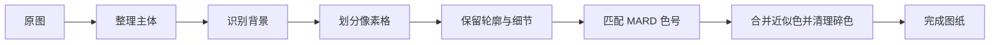

<div align="center">
  
  <h1>拼豆图纸生成器</h1>
  <p>把照片变成真正能照着拼的 MARD 拼豆图纸</p>
  <p>
    <a href="https://pindou.kuizuo.me"><strong>在线体验</strong></a> ·
    <a href="#快速开始">本地运行</a> ·
    <a href="#可选安装-skill">安装 Skill</a>
  </p>
  <p>
    
    
    
    
  </p>
</div>


<p align="center">
  <a href="https://pindou.kuizuo.me">
    
  </a>
</p>

## 亮点

| 🎨 MARD 291 色 | 🧩 真正能拼 |
| --- | --- |
| 自动匹配接近的 MARD 色号，并统计每种颜色的用量。 | 区分白色豆与空白格，控制颜色数量并清理零碎色块。 |
| **✏️ 逐格精修** | **🔒 本地优先** |
| 裁剪、像素化、逐格修改，持续保存当前图纸。 | 无需注册；默认在浏览器处理，作品只保存在当前设备。 |

## 快速开始

```bash
git clone https://github.com/kuizuo/pin-dou.git
cd pin-dou
bun install
bun run dev
```

打开 `http://localhost:3000`，选择图片即可开始。

## 可选：安装 Skill

在支持 Skill 的工具中，也可以通过对话生成拼豆图纸：

```bash
npx skills add kuizuo/pin-dou --skill image-to-pindou -g -y
```

安装后，发送图片并说：

```text
使用 $image-to-pindou，把这张图片做成 50×50 的拼豆图纸，移除背景，最多使用 18 种颜色。
```

## 转换流程



复杂照片会先整理成轮廓清楚、色块稳定的像素稿；简洁插画可以直接转换。背景只从画面边缘开始识别，减少误删主体内部的浅色区域。

<details>
<summary><strong>AI 与 Cloudflare 配置</strong></summary>

AI 模式支持 Cloudflare AI 和 Gemini 3.1 Flash Image。Gemini 密钥只保存在当前浏览器，不会写入作品或备份。

本地联调 Cloudflare 时，将 `.env.example` 复制为 `.env.local`，将 `worker/.dev.vars.example` 复制为 `worker/.dev.vars`，再分别运行 `bun run dev` 和 `bun run worker:dev`。

</details>

<details>
<summary><strong>本机 DSH 订阅图片通道</strong></summary>

“DSH 订阅”选项通过服务端访问本机 DeepSeek Harness 的图片桥接入口。DSH 插件持有订阅登录信息，浏览器和拼豆服务都不读取订阅凭据。部署时为拼豆服务设置 `DSH_IMAGE_BRIDGE_URL`（例如 Docker 中的 `http://host.docker.internal:18789`）和 `DSH_IMAGE_BRIDGE_TOKEN_FILE`（只读挂载的桥接令牌文件）；桥接入口只监听宿主机 `127.0.0.1`。图片编辑请求沿用 DSH 当前的图片型号和质量设置。连接状态会显示在 AI 设置中。

</details>

## 开发检查

### 可选：电脑 GPU 高质量通道

原有浏览器标准算法及 AI 图片通道保持独立，默认仍为浏览器标准。在图片准备界面或图纸设置的“图纸配色”中，选择“电脑GPU高质量”即可调用新增通道。

- 电脑运行独立 CUDA 服务；手机通过拼豆网站的同源接口提交取样颜色，使用电脑显卡。
- 新通道使用保细节取样、CIEDE2000 固定 MARD 色盘优化及原色直接匹配。平均色、主色模式仍可选择。
- 新增 `GET /api/gpu/health` 与 `POST /api/gpu/quantize`，服务认证令牌仅在服务端读取。
- 服务离线时会提示失败并保留现有图纸；可手动切换浏览器标准，不会静默替换结果。
- 新图保存生成基线与引擎信息；旧作品与备份继续兼容。
- GPU 的“轮廓增强”模式可切换“自然平衡”：以线性光平均色约束亮度，减轻浅色发灰，并有限保留局部代表色；“原细节增强”继续保留，旧设置默认不变。

安装、启动、停止和 CUDA 测试见 [GPU 服务说明](services/gpu/README.md)。启动电脑服务后，为 Next 服务配置 `GPU_SERVICE_URL` 和 `GPU_SERVICE_TOKEN_FILE`，见 `.env.example`。

Docker 运行时使用 `GPU_SERVICE_URL=http://host.docker.internal:8766`，并将 `services/gpu/.runtime/token.txt` 只读挂载到容器，再将 `GPU_SERVICE_TOKEN_FILE` 指向该挂载路径。GPU 服务默认监听 `0.0.0.0:8766` 并要求 Bearer 认证，浏览器不直接连接该端口。

电脑重启后可运行 `services/gpu/start.ps1` 恢复 GPU 服务；普通浏览器转换不依赖该服务。

自然取样、低格数取舍与可选 Jev 决策评审工具见 [优化说明](docs/gpu-natural-optimization.md)。决策评审是显式运行的研究工具，网页转换不会自动调用 OpenRouter。

### 检查命令

```bash
bun run test
bun run lint
bun run typecheck
bun run build
bun run worker:check
```

## 数据与许可

- [`maxcleme/beadcolors`](https://github.com/maxcleme/beadcolors)：提供 MARD 291 色数据。
- [`magic-wand-tool`](https://www.npmjs.com/package/magic-wand-tool)：用于识别与图片边缘相连的纯色背景。
- [`react-zoom-pan-pinch`](https://www.npmjs.com/package/react-zoom-pan-pinch)：用于画布缩放与平移。
- [`color-diff`](https://www.npmjs.com/package/color-diff)：用于将图片颜色匹配到 MARD 色号。
- [`CIawevy/pindou-skill`](https://github.com/CIawevy/pindou-skill)：拼豆图纸 Skill 的参考项目。
