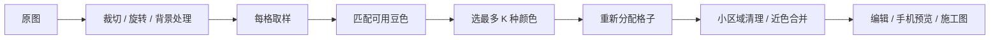

# 图像转拼豆：算法、前端架构与 GPU 路线调研

调研日期：2026-10-20。对象为当前 `E:/project/pindou` 工作区，包括已有本地修改。

证据来源：本项目源码与测试、社区项目实际源码、浏览器官方文档、算法作者论文。本文中的优先级和架构方案是针对本项目的判断。合成用例证明具体问题存在，不代表真实图片集上的平均收益。

## 1. 判断

**有明确的算法优化空间，也值得拆分图像处理内核。现有 React / Next.js 可以继续使用。GPU 适合作为计算后端，画质提升需要同时改进采样、选色和结构保留。**

建议分开看三个目标：

| 目标 | 关键改动 | GPU 的作用 |
|---|---|---|
| 同样图片、格数、色数，更像原图 | 保留原始采样颜色，优化固定色卡子集，保护五官和细线 | 加速候选评估与迭代，让更复杂的算法可交互 |
| 拖参数、生成、编辑更流畅 | 阶段缓存、Worker、避免旧任务覆盖新结果、画布像素预算 | 并行处理高计算量阶段 |
| 做更大的图纸 | 分块计算、按视窗绘制、分板导出、紧凑存储 | 承担大量格子的颜色计算；不能替代内存与导出设计 |

“使用 GPU”本身不增加格数、可买到的豆色或原图信息。保持同一算法时，理想输出应当相同；GPU 浮点误差可能使极接近的候选颜色出现不同选择。

## 2. 当前项目已经做了什么

本地依赖：Next 16.3.0，React 锁文件实际版本 19.2.8，TypeScript 6.0.3，Tailwind 4.3.3，Canvas2D，IndexedDB。这些是本地版本记录，不是“全网最新版本”结论。



| 阶段 | 当前实现 | 评价与代码位置 |
|---|---|---|
| 输入与变换 | 处理图最长边 1600px，裁切、旋转、镜像；输出 16–192 格正方形板，内容保持比例 | 有资源上限；`lib/pattern.ts:106,135,602` |
| 降采样 | 先由 Canvas 重采样到目标格数的 8 倍，再处理每格 8×8 样本 | 已做 alpha 加权和线性光平均；`lib/pattern.ts:446,505,573` |
| 主色 / 轮廓 | RGB 分桶选主色；相邻格色差达到阈值时切换主色 | 是局部启发式，没有识别眼睛、细线或轮廓方向；`lib/pattern.ts:541` |
| 颜色距离 | sRGB→CIELAB，CIEDE2000 匹配真实 MARD 色号 | 值得保留；`lib/beads.ts:5,36,63` |
| 限制用色 | 最常见色起步，再按“离已选色的最小色差 × √频数”贪心选色 | 可以保留占比小但差异明显的颜色；尚未优化整体重建误差；`lib/pattern.ts:282` |
| 施工简化 | 连通小色块清理、相近色合并 | 可减少零散豆，同时可能损失细节；`lib/pattern.ts:321,366` |
| 去背景 | 边界主色采样、连通填充、区域比例保护 | 适合纯色背景；`lib/background.ts:34` |
| AI | 可选生成前处理，随后校色，再走本地采样和配色 | 最终实体色卡约束仍由本地算法完成；`lib/ai.ts:42,137` |

现有 `tests/color-diff.test.ts` 包含 CIEDE2000 的 34 组标准参考数据。`tests/beads.test.ts` 已覆盖透明度、线性光平均、小面积重要颜色、颜色上限等用例。无需重新发明这些基础。

## 3. 已确认的画质问题

### 3.1 最终映射发生二次量化

当前 `lib/pattern.ts:401–425`：

```text
采样 RGB → 全部可用豆色中的最近色 → 最终 K 色中的最近色
```

建议：

```text
保留采样 RGB/Lab → 最终 K 色中的最近色
```

对同一固定最终色盘、同一距离函数，在后续区域清理之前，直接寻找最近色的逐格色差不会高于间接映射。这是可以单独完成的小改动。

已复现的合成用例：201×1，100 个黑色、100 个白色，最后一个像素为 RGB(16,112,208)，最多 2 色，average 模式，关闭近色合并。

| 方案 | 最后一格结果 | 原 RGB 到结果的 ΔE00 |
|---|---|---:|
| 当前：先匹配 C7，再映射 H7/T1 | T1 白 | 46.5099 |
| 从原 RGB 直接匹配同一个 H7/T1 色盘 | H7 黑 | 42.3032 |

这一个像素的误差减少约 9.04%。它只证明存在多余误差，不能宣传为“全图画质提高 9%”。

### 3.2 限色应该优化“这张图最需要哪 K 种豆色”

当前选色先把原图颜色归到豆色上，再根据频率和色差选代表。原始颜色偏差在这个阶段已经丢失，也没有在选完之后进行替换优化。

可研究的目标：

```text
从允许的实体色卡 A 中选择 S，|S| ≤ K
最小化 Σ 权重(i) × min[色差(采样色(i), 豆色(c))，c∈S]
```

一种可落地实现：

1. 保留原采样 Lab；相同颜色可合并并记录权重。
2. 按“加入该候选色能让总误差减少多少”逐步添加豆色。
3. 对已选颜色做少量交换，保留能改善目标的替换。
4. 对最终色盘，从原采样色重新分配所有格子。
5. 将用户锁定颜色、五官 / 细线保护作为附加约束。

这属于固定候选集合下的离散优化。自由 K-means 后再贴到实体色卡可能把多个中心映到同一豆色，因此不能默认它就是更优解。它适合做候选基线。

颜色误差较低也不一定更好拼；应同时观察细节、孤立格、实际颜色数和人工修正量。

### 3.3 根据图片类型选择采样方式

| 图片类型 | 建议实验方向 | 需要观察的副作用 |
|---|---|---|
| 人像 / 照片 | 面积平均、保细节降采样、平滑区域低强度抖动 | 皮肤变脏、毛发噪点、零散豆增加 |
| 动漫 / 插画 | 边缘方向与局部高对比保护，保护眼睛和轮廓 | 锯齿、线条过粗、局部色偏 |
| 已有像素图 | 网格对齐、中心 / 最近邻取样、保留色块 | 错半格会明显破坏形状 |
| 文字 / Logo | 细线连通与结构优先，少量人工保护点 | 单纯降噪可能删除笔画 |

可参考 [DPID 作者代码](https://github.com/mergian/dpid)和[感知降采样论文作者页面](https://cgl.ethz.ch/publications/papers/paperOzt15b.php)。这类方法改善降采样阶段的细节分配，但也可能强化噪点，必须与现有线性光平均做图片集对照。

更远期可研究同时优化空间与颜色的 [Pixelated Image Abstraction](https://cragl.cs.gmu.edu/pixelate/)。它会调整局部形状，且需要适配固定 MARD 色卡，适合作为单独的像素艺术模式。

### 3.4 AI 校色可能跨区域串色

`lib/ai.ts:42–103` 把全图生成颜色按粗 RGB 桶分组，再选择最常见的原图颜色。分组不含空间位置。

已复现：

- 原图三个像素：红、红、蓝。
- 生成图三个像素：RGB(80,80,80)、(81,81,81)、(82,82,82)，落在同一个桶。
- 校色结果：红、红、红。

建议按区域或局部簇校色，并检查生成图与原图的空间对应。GPU 可以加速计算，但改变这一行为需要调整校色算法。

### 3.5 其他可以分步改的细节

- alpha 覆盖率与颜色采样分离，让透明轮廓的保留程度可控制。
- 小区域清理增加结构保护，避免误删眼睛、字母点或单格亮点。
- “允许最多 K 色”和“减少施工复杂度”分别控制，避免近色合并导致用色数下降却难以解释。
- 小色库目前部分由 RGB 最远点选取。如果产品表示实际购买套装，需要使用真实套装色号清单。
- 实体还原还受色卡 RGB 准确度、材料、照明和显示器影响。色卡校准是独立的改进方向，需要实物测量依据。

## 4. 社区方案对比

| 方案 | 实际能力 | 对本项目的价值 |
|---|---|---|
| [image-q](https://ibezkrovnyi.github.io/image-quantization/) | 多种量化、CIEDE2000、给定调色板映射、误差扩散 | 适合做替换实验和抖动基线；async API 不等于 Web Worker |
| [RgbQuant.js](https://github.com/leeoniya/RgbQuant.js) | 颜色直方图、预定义色盘、抖动阈值、蛇形扫描 | 缓存和抖动控制值得参考；其 RGB 距离不构成本项目感知配色的自然升级 |
| [Pixelit 源码](https://raw.githubusercontent.com/giventofly/pixelit/master/dist/pixelit.js) | 缩小再最近邻放大，RGB 最近色 | 适合简单像素效果；本项目已有更细致的颜色与取样处理 |
| [Hon-Wong/pindou 源码](https://raw.githubusercontent.com/Hon-Wong/pindou/main/js/quantize.js) | 面积、主色、2-means 保边、DPID、感知降采样，Lab 聚类、色卡映射和抖动 | 最值得做多类型图片 A/B 的参考；README 中的效果数字不能直接套到本项目 |
| [Perler Studio 图纸实现](https://raw.githubusercontent.com/real-jiakai/perler-studio/main/src/lib/pattern.ts) | 固定品牌色卡、CIEDE2000、匹配缓存、索引数组、透明边界下的抖动 | 纯算法边界和缓存值得参考；未找到适用源码许可，作为研究参考 |
| [Pica](https://github.com/nodeca/pica) | 浏览器高质量缩图、Worker / WASM、分块限制峰值内存 | 可比较预缩图质量与工程组织；它不解决最终实体色卡的 K 色选择 |

许可证核验：[Hon-Wong/pindou](https://github.com/Hon-Wong/pindou/blob/main/LICENSE)、[image-q](https://github.com/ibezkrovnyi/image-quantization/blob/main/packages/image-q/LICENSE)、[Pica](https://github.com/nodeca/pica/blob/master/LICENSE) 为 MIT；直接复用时保留原许可和第三方声明。Perler Studio 公开仓库未发现 LICENSE 或 package 许可声明。

## 5. 目前适合采用的前端技术

| 技术 | 是否采用 | 本项目中的职责 |
|---|---|---|
| React / Next / TypeScript | 保留 | 界面、状态、路由、已有服务接口 |
| Canvas2D | 保留并改进绘制策略 | 图纸绘制；限制背板像素数，分离底图 / 网格 / 高亮层 |
| Web Worker | 优先 | 让计算离开界面线程，配合任务序号和过期结果丢弃 |
| OffscreenCanvas | 能力检测后使用 | 将部分 Canvas 工作放入 Worker；不支持的环境保留适配器 |
| TypedArray + Transferable | 优先用于内核 | 连续像素 / 索引数据，减少跨线程复制 |
| WebAssembly | 根据测量决定 | 复用高质量原生算法或加速稳定 CPU 热点 |
| WebGPU | 可选计算后端 | 批量采样、颜色距离、候选评分、部分滤波 |
| ONNX Runtime Web | 复杂背景 / 结构辅助的可选模块 | 本地分割等模型；需要模型下载、内存预算和回退 |
| IndexedDB | 保留 | 本地图纸与原图存储；优化读取粒度 |

[OffscreenCanvas](https://developer.mozilla.org/en-US/docs/Web/API/OffscreenCanvas)可在 Worker 中运行；[ArrayBuffer 转移](https://developer.mozilla.org/en-US/docs/Web/API/Web_Workers_API/Transferable_objects)能够转移所有权，转移后发送端原缓冲区不可继续使用。Worker 优先改善响应性，并不保证总计算时间减少。

[ONNX Runtime Web](https://onnxruntime.ai/docs/tutorials/web/)有 WASM 与 GPU 执行后端，但 GPU 后端的算子支持有差异。引入分割模型应与普通转图分开加载和评估。

## 6. GPU 能做什么，以及怎样提升效果

### 6.1 两条部署路线

本机 `nvidia-smi` 检测到 NVIDIA GeForce RTX 5070 Ti，显存 16303 MiB，驱动 610.88。

| 路线 | 使用哪块 GPU | 适用情况 | 成本 |
|---|---|---|---|
| 浏览器 WebGPU | 打开网页的设备上的 GPU | 本机使用、离线工具、无需传图 | 每台设备性能和兼容性不同；手机用手机 GPU |
| 本机 GPU 服务 | 运行服务的电脑上的 RTX 5070 Ti | 手机也希望使用电脑算力、较重的模型或多候选算法 | 新增 GPU 后端、图像传输、任务管理；电脑需要在线 |

WebGPU 不会让手机网页自动调用电脑显卡。如果要手机复用本机 GPU，需让现有前端通过接口提交任务，由电脑计算后返回图纸数据。

浏览器端已有 [Chrome / Edge / Firefox / Safari 的 WebGPU 支持](https://web.dev/blog/webgpu-supported-major-browsers)，实际可用性仍与系统、驱动、硬件和版本有关，必须调用 `requestAdapter()` 验证并准备回退。

WebGPU 还要求安全上下文。当前电脑的 `http://127.0.0.1:3001` 属于本地回环例外；手机若通过普通 `http://192.168...` 访问电脑，通常不满足条件，需要 HTTPS。这是部署条件，而不是手机 GPU 性能问题。见 [requestAdapter](https://developer.mozilla.org/en-US/docs/Web/API/GPU/requestAdapter)与[安全上下文规则](https://developer.mozilla.org/en-US/docs/Web/Security/Defenses/Secure_Contexts)。

后端路线可以采用 CUDA 数组计算或自定义 kernel，例如 [CuPy](https://docs.cupy.dev/en/stable/overview.html)。应先对同一算法进行小规模测量，再决定框架；无需为一个简单最近色匹配引入大型训练系统。

### 6.2 适合并行的阶段

| 阶段 | GPU 适配度 | 说明 |
|---|---|---|
| 颜色空间转换、线性光取样 | 高 | 大量独立像素 / 格子可以并行 |
| 每格匹配 291 种豆色 | 高 | 每格独立扫描色卡，只输出最佳索引 |
| 多组候选色盘的误差评分 | 高 | 对大量像素重复相似计算 |
| 保边滤波 / 降采样 | 较高 | 规则的局部邻域计算；需保证透明与颜色空间处理正确 |
| 当前 291 点以内的贪心选色 | 有限 | 数据规模小；更适合先留 CPU，避免频繁同步 |
| 连通域、小块合并 | 中低 | 可以实现，但复杂度较高，第一版保留 CPU |
| Floyd–Steinberg 误差扩散 | 低至中 | 后续像素依赖前面误差，不能直接把所有像素独立并行 |
| 网格绘制 | 可选 | 先限制像素预算和可视范围；换 GPU 仍要管理纹理内存 |

### 6.3 质量路线

**第一阶段：相同算法的 GPU 后端。** 保留 CIEDE2000 与实体色卡，以 CPU 作为正确性基线，确认颜色选择一致性、上传与读回开销、冷启动时间。收益首先体现在计算时间和响应性。

**第二阶段：更好的选色目标。** 对固定 MARD 色卡执行候选边际收益评分、少量交换与多初始方案比较。最终从原始采样色直接匹配最终色盘。GPU 用于承担更充分的搜索。

**第三阶段：结构优先的多候选。** 对照片、插画、像素图选择不同采样策略；探索少量网格偏移、边缘保护强度和抖动强度，比较色差、结构和零散格，再提供少量候选图供用户选择。不能只按均方误差判定眼睛、文字是否保住。

**第四阶段：可选模型辅助。** 用分割或结构预测辅助去背景与细节保护。生成式重绘可能改变原图内容，适合作为单独风格模式，不应将其结果等同于忠实还原。

### 6.4 内存与规模

以下为数学推导，不是显存实测。项目目前仍限制 192 格，512 / 1024 是未来扩大规模时的推导：

| 格数 | 单次匹配 291 色的距离计算数 | 保存完整 Float32 距离矩阵 |
|---|---:|---:|
| 65×65 | 1,229,475 | 约 4.69 MiB |
| 192×192 | 10,727,424 | 约 40.92 MiB |
| 512×512 | 76,283,904 | 291 MiB |
| 1024×1024 | 305,135,616 | 1164 MiB |

单纯最近色匹配无需保存完整矩阵：每个格子扫描色卡，只保留最佳色号和距离。若迭代选色需要复用距离，可先按颜色合并权重、分块或只缓存有预算的部分。

更大的图纸仍然需要绘制和导出改造。当前编辑器显示色号时每格 24px，再乘设备 DPR；192 格、DPR=3 时 backing canvas 是 13824×13824，单份 RGBA 理论 729 MiB。这个问题不能靠把量化迁到 GPU 消除。

### 6.5 GPU 验证要求

- 区分硬件适配器与 SwiftShader 等软件适配器。
- 分开报告初始化、shader 编译、暖运行和完整上传 / 计算 / 读回耗时。
- 用相同输入、同一距离公式比较 CPU / GPU；统一色盘和透明阈值。
- 测 CIEDE2000 标准参考对；记录色号不一致数、对应误差、近似并列情况。
- [WGSL 浮点精度](https://www.w3.org/TR/WGSL/#floating-point-accuracy)与 JavaScript 双精度不同，不能要求所有中间值逐位相同。
- 对旧任务使用序号丢弃结果；已提交 GPU 工作不能假设可以立即中断。
- 处理设备丢失并回退，见 [GPUDevice.lost](https://developer.mozilla.org/en-US/docs/Web/API/GPUDevice/lost)。
- 同算法跑得更快只能证明性能收益；画质提升须用改进算法和图片集另测。

### 6.6 本机 WebGPU 微基准实测

已经完成隔离实验，未接入应用运行路径。环境为 Windows、Chrome 155.0.8059.84 headless、RTX 5070 Ti；WebGPU 报告 NVIDIA / Blackwell，`isFallbackAdapter=false`，并禁用了软件光栅回退。

实验采用实际 291 色 MARD 色卡和固定随机种子的 RGB 输入。两端计时前都已完成 RGB→Lab，并使用相同 Float32 化的 Lab 输入；CPU 继续调用项目的 `color-diff 1.4.0` 公式，GPU 使用对应 WGSL 公式。

下表是预热后 3 次运行的中位数。GPU 时间包含样本上传、提交、等待完成、读回与 JS 结果复制，复用已分配缓冲区和常驻色卡：

| 网格 | 当前 JS 配色内核 | WebGPU 配色内核 | 色号不同格数 |
|---|---:|---:|---:|
| 65×65 | 231.6 ms | 2.7 ms | 0 / 4,225 |
| 128×128 | 1,815.4 ms | 3.7 ms | 0 / 16,384 |
| 192×192 | 4,021.8 ms | 4.0 ms | 0 / 36,864 |

这支持在本机继续开发 GPU 配色后端。解读时有以下边界：

- **只测一次固定色卡最近色匹配。** 没有测解码、采样、限色优化、清理、绘制、PNG 编码；不能把表中的时间或比率当成完整转图结果。
- **首次初始化有成本。** adapter、device、pipeline 初始化合计约 366.7 ms；加上传色卡和首次 65 格匹配约 372.3 ms。本次 CPU 首次 65 格匹配约 233.8 ms，因此小图冷启动并非 GPU 更快。
- **这是本机、一次实验进程内的结果。** 128 格 CPU 三次样本为 1151.8 / 1841.5 / 1815.4 ms，有明显波动。没有与优化过的 WASM、原生 CPU 内核或重复色缓存比较。
- **本次 57,473 格的最终色号全部一致。** 这不保证所有输入和设备逐格一致，更不代表画质提升。
- **精度检查未完全满足原单测的严格门槛。** 34 个标准参考对的最大绝对偏差为 0.00005696 ΔE；按现有 `toBeCloseTo(expected, 4)` 的约 0.00005 门槛，有 1 项略超。2,048 个随机对相对 CPU 双精度参考的最大偏差为 0.00007170。接入前应明确误差契约、近并列候选处理和多设备验证，不能宣称原 34 项全部通过。
- 桌面 Chrome 的结果不能代表 Codex 内置浏览器或手机。手机端仍需要独立测试。

复核材料：`output/gpu-research/results.json`、`benchmark.ts`、`ciede2000.wgsl`、`run.cjs` 和实验目录 README。原始 JSON 保留所有时间样本、误差、适配器信息和源码哈希。

## 7. 有明确收益预期的渐进重构

建议边界：

```text
界面 / 编辑状态
    ↓ GenerationJob（任务序号、进度、阶段缓存）
纯算法内核
    ├─ sample：采样与遮罩
    ├─ palette：实体色卡子集选择
    ├─ assign：原采样色直接映射
    └─ simplify：结构保护与施工简化
计算后端
    ├─ Worker CPU：基线与回退
    └─ WebGPU / GPU服务：重计算阶段
渲染器
    ├─ 编辑视窗
    ├─ 手机分享预览
    └─ 施工图 / 分板导出
```

| 优先级 | 改动 | 当前证据 |
|---|---|---|
| P0 | 修正二次量化，保留原始采样色 | 已有数值反例 |
| P0 | 限制编辑器 backing 像素预算，按缩放显示色号 | 192格 / DPR3 的理论内存过大 |
| P1 | 一次扫描同时产生平均色和主色；预计算 sRGB→linear LUT | 当前同一 tile 重复处理；`lib/pattern.ts:446,505` |
| P1 | 缓存解码、裁切、采样、Lab 和生成基线 | 调参数时旧结果与新结果重复生成；`components/workspace/result.tsx:932` |
| P1 | Worker 与可选 GPU 后端 | 当前 async 函数中的 CPU 内核仍在主线程；`lib/pattern.ts:621` |
| P1 | 笔画中按帧合并状态与绘制，分层 / 脏区域更新，结束后提交 | 已有笔画结束保存和历史；笔画中单格修改仍复制 cells、全量重画；`lib/editor.ts:1`、`components/pattern-canvas.tsx:91` |
| P1 | 导出按需异步生成，用 Blob / object URL 复用 | 打开预览生成两张 Canvas，下载再次生成 |
| P2 | 单作品按 ID 读取，列表用缩略图 | `lib/projects.ts:56`、`components/workspace.tsx:158` |
| P2 | 自动备份合并待处理版本 | 当前逐图 Base64、全库 stringify；`lib/projects.ts:350` |

`lib/pattern.ts` 混合图像 I/O、采样、量化和导出；`components/workspace/result.tsx` 混合生成调度、编辑历史、保存与导出。先抽这些职责边界，GPU 和 CPU 才能共享一致的输入输出契约。

内部可以使用 `Uint16Array` 色号索引；对已有图纸文件保留转换适配，避免为计算优化同时引入不必要的数据迁移。

## 8. 验收方法

固定图片集：照片人像、宠物毛发、动漫五官、细线文字、Logo、透明插画、已有像素图、肤色和天空渐变。

固定参数：32 / 65 / 128 / 192 格，8 / 12 / 24 等颜色预算，同一裁切、同一允许色卡、同一背景策略。

| 维度 | 需要记录 |
|---|---|
| 颜色 | 平均 / 高分位 ΔE，实际用色数；明确参考采样方法 |
| 结构 | 眼睛、细线、文字是否保留；轮廓连通；人工盲选 |
| 施工 | 单格孤岛、小区域数量、人工修正格数 |
| 速度 | 冷启动、暖运行中位数、端到端时间、主线程长任务 |
| 内存 | 输入与中间缓冲、Canvas 像素预算、GPU buffer 预算 |
| 手机 | 真实 Android / iPhone 的生成、缩放、保存与导出 |

已有单元测试适合保证公式和确定性行为；mock Canvas 的导出测试不能证明手机上的真实画布内存与下载表现。GPU 微基准也不能替代完整图片流程测试。

推荐顺序：先建立基线和修复明确误差 → 验证 GPU 后端 → 升级固定色卡选色 → 按图片类型试验保细节采样 → 再决定更大规模图纸与模型辅助。
